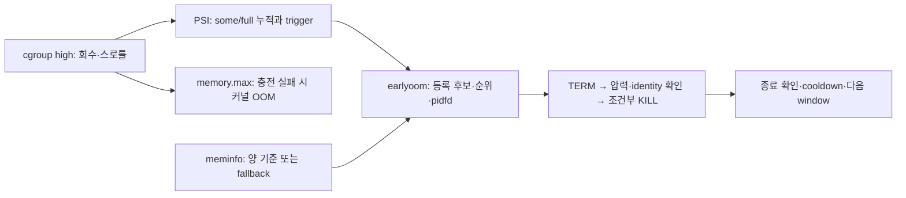

# Assignment 10 — OOM, earlyoom, 메모리 진단

Linux 7.3.4-arch1-2, x86-64, 페이지 4 KiB, GCC 16.2.1, glibc 환경이다. 호스트의 swap은 zram이며 전용 부모 cgroup의 `memory.swap.max`는 0으로 설정했다. `vm.overcommit_memory=0`을 읽고 그대로 사용했다. 실험기는 384 MiB transient user unit의 observer에, 대상은 각각의 하위 cgroup에 배치했다. [프리플라이트](evidence/preflight.txt), [명령과 재현](README.md)

## Level 1 — 커밋, 거주, OOM 범위

**예측.** 64 MiB 예약은 touch 전에는 64 MiB의 RSS를 만들지 않는다. B의 외부 workload는 더 큰 resident footprint를 가지더라도 B의 memcg 후보 범위에 들지 않는다. C에서는 그룹 kill이 켜져 있으므로 가장 큰 적격 task가 첫 victim이라도 동일 그룹의 적격 동료도 함께 종료된다.

- `reserve`는 64 MiB mmap 성공 직전과 직후에 Committed_AS가 34,678,496 → 34,744,032 KiB로 65,536 KiB 증가했다. 8 MiB씩 4번 touch한 뒤 그룹 peak는 32.93 MiB였다. 전역 커밋값에는 다른 프로세스의 변화가 섞인다. strict overcommit은 예약 시점의 커밋 한도 초과에 ENOMEM을 반환할 수 있고, 실행 중 memcg 충전 실패를 막지는 못한다. [commit과 touch](evidence/reserve/work-0.txt), [group/PSS](evidence/reserve/checkpoints.json)
- 4/12/24 MiB 프로세스의 정규화 oom_score는 초기에는 모두 800이었다. 가장 작은 프로세스를 adj +500으로 올리니 1000이 됐다. +200으로 복귀는 성공했고 0/-1/-1000 요청은 거부됐다. 별도 fork와 exec 확인에서 adj 500이 유지됐다. `-1000`은 후보 제외이며, raw badness의 adj 스케일은 적용되는 자원 budget에 비례한다. [adj 확인](evidence/adj-checks.txt)
- 이 시스템에서 dmesg 직접 읽기는 EPERM이었다. kernel journal에서 보고서를 단조 시각과 그룹 경로로 찾아 requester, task table, scope, victim을 파싱했다. 현재 부팅의 journal을 읽고 과제별로 필요한 원문을 내보냈다. 재부팅 뒤 보존성은 측정하지 않았다. kernel log 없이 ENOMEM이나 userspace signal을 OOM 보고서로 해석할 수 없다. [수집기](analysis/collect_oom_journal.py), [파서](oomparse)

| Case | Scope, requester/order | 실제 종료 | victim adj / anon·file·shmem KiB | 이벤트 증분 |
|---|---|---|---|---|
| B 40 MiB | MEMCG, memhog/0 | 33075, 종료 -9 | 200 / 40,812·1,916·0 | max 46, oom 1, oom_kill 1 |
| B 40 MiB + 외부 부담 | MEMCG, memhog/0 | 내부 worker -9, 외부 PID 40758 생존 | [journal 파싱](evidence/oom-B-outside/oomparse.jsonl) | max 39, oom 1, oom_kill 1 |
| C 56 MiB | MEMCG, memhog/0 | 33083, 33084, 33122 모두 -9 | 첫 victim 200 / 24,676·1,924·0 | max 36, oom 1, oom_kill 3, oom_group_kill 1 |
| A/D | 전역 disposable VM 또는 공급 로그 필요 | 미측정 | — | — |

C는 56 MiB ÷ 4 KiB = 14,336 pages, swap budget 0이다. task table의 예상 raw badness를 `rss_pages + swapents + floor(pgtables_bytes / page_size) + adj × floor(total_pages / 1000)`으로 계산했다. PID 33083은 6,650 + 0 + 24 + 2,800 = **9,474**, PID 33084는 5,819 + 0 + 22 + 2,800 = **8,641**, PID 33122는 **6,053**이다. 첫 victim의 순서는 이 계산과 맞았고, 이후 추가 두 kill은 group 설정으로 설명한다. 시작한 task와 victim은 별도 로그 필드다. A에서는 총 RAM+swap, D에서는 -1000 제외 후 같은 budget의 나머지 후보를 비교해야 한다. A/D 공급 fixture를 현재 자료에서 찾을 수 없었다. [B 원문과 파싱](evidence/oom-B/oomparse.jsonl), [외부 생존 로그](evidence/oom-B-outside-console.txt), [C journal](evidence/oom-C/kernel-oom.log), [C 파싱](evidence/oom-C/oomparse.jsonl)

`memory.high`는 회수와 throttling을 유도한다. `memory.max`에 도달해도 회수에 성공하면 계속 진행할 수 있다. 충전 실패 때 memcg OOM이 발생하고, kill 신호 뒤 oom_reaper와 정상 종료 경로가 회수할 수 있는 매핑의 범위와 시점은 서로 다르다. 공유 페이지나 pinned 메모리 때문에 RSS 전체가 즉시 반환된다고 볼 수 없다.

## Level 2 — earlyoom 소스 경로와 정책

Upstream v1.9.0의 full commit은 `202d4db0d308ca6478f68de68b46cae34896ddaf`다. `main.c`의 meminfo loop는 여유량에 따라 sleep을 조절한다. MemAvailable과 swap 여유가 기준 아래면 `kill.c`에서 후보를 고른다. 기본은 oom_score이고, `--sort-by-rss`는 VmRSS 기준으로 바꾼다. `--prefer/--avoid`는 순위를 보정하고 `--ignore`는 후보를 제외한다. `-p`는 nice -20과 adj -100을 요청한다. 원본 `kill_release`는 **kill(pid, sig)** 을 실행한 뒤 pidfd로 `process_mrelease`를 시도한다. pidfd를 미리 열어도 원본의 숫자 PID 신호에는 재사용 race 창이 남는다. [원본 main](vendor/earlyoom/main.c), [원본 kill](vendor/earlyoom/kill.c), [pinned tag](evidence/upstream-tag.txt)

course `--lab` 경로에서는 등록부의 후보 역할, start ticks, cgroup membership을 확인한 뒤 pidfd로만 신호를 보낸다. A는 meminfo와 PSI의 OR, B는 floor(900 → 700 → 200 → 0), 높은 adj/RSS/낮은 PID 순이다. C는 trigger 및 신호 시각을 기록하고, PSI에서 시작한 TERM 후 grace 동안의 압력을 다시 확인한 다음 필요할 때만 KILL을 보낸다. 받은 pidfd로 종료를 확인하고 cooldown 뒤 fresh window에서 다시 판단한다. 2개 clean window와 meminfo 회복에 floor를 900으로 되돌리고, missing/reset PSI는 회복 판정에서 제외한다. meminfo의 TERM/KILL 임계값은 별도로 유지한다. [A/B](earlyoom-patches/AB-policy.patch), [C](earlyoom-patches/C-timing.patch)

호스트 빌드와 synthetic policy check가 통과했다. 로컬 dry-run의 빈 등록부는 `no_candidate`를 기록했다. 별도 실행에서 등록 PID만 선택했고 observe 역할과 그룹 외부 PID는 건너뛰었다. unprivileged some/1 s trigger 등록은 EINVAL을 받아 명시적으로 meminfo 경로로 후퇴했다. 네 가지 보드 설정 3회씩, 70/150/300 ms screening, idle 10분 footprint, target ABI/port와 platform killer 비교는 지정 보드가 없어 미검증이다. 런타임에서 관측한 fallback은 PSI 보드 실험을 대신하지 않는다. [빌드](evidence/earlyoom-build.txt), [정책 검사](evidence/policy-checks.txt), [dry-run](evidence/earlyoom-smoke.txt), [등록 범위 검증](evidence/earlyoom-registry-check.txt), [patch series 빌드](evidence/earlyoom-patch-series.txt)

## Level 3 — 밖에서 안으로 좁혀 수정 검증

| 증상 | 확인 순서 | 독립 확인 | 수정 |
|---|---|---|---|
| M1 시간이 지날수록 cgroup current 증가 | meminfo → cgroup anon → process PSS → allocation site | exit dump의 `event_create` callsite에 10 × 4 MiB 보유 | 포인터를 지우기 전에 `free` |
| M2 재생 때 프로세스 종료 | 그룹 peak/events → journal MEMCG scope → 프로세스 로그 | 80 MiB에서 같은 56 MiB payload의 peak가 반복 후 내려감 | `memory.max` 40 → 80 MiB |
| M3 완료까지 지연 | 그룹 PSI/high → current/PSS → 완료 사이클 동일 비교 | PSS peak는 양쪽 약 40.13 MiB, high·PSI는 낮은 경계에서만 증가 | `memory.high` 38 → 64 MiB |

- **M1.** 10사이클을 동일 seed 42로 전후 각 3회 실행했다. 그룹 peak 중앙값은 49.23 → 13.00 MiB, 종료 live requested bytes는 41,947,136 → 4,096 B였다. 남은 4,096 B는 libc 호출 위치로 분리됐다. RSS/PSS는 libc 내부 유지와 page-level 회수 정책 때문에 요청 바이트와 정확히 일치하지 않는다. [M1 그래프](evidence/M1-before-after.png), [원본 trace](evidence/M1-original-1/work-0.txt), [수정 trace](evidence/M1-fixed-1/work-0.txt), [소스 patch](scenario-patches/M1-free-expired.patch)
- **M1 장시간 검증.** seed 42, 128 KiB × 300회, 8 MiB base로 전후 모두 약 302초와 300사이클을 완료했다. 그룹 peak는 48.00 → 9.00 MiB, 종료 live requested bytes는 39,325,696 → 4,096 B였다. [장시간 원본](evidence/long-M1-original/work-0.txt), [장시간 수정](evidence/long-M1-fixed/work-0.txt)
- **M2.** 8 MiB base와 48 MiB의 peak를 같은 schedule로 시도했다. 40 MiB에서 `max +22`, `oom_kill +1`로 종료됐다. 80 MiB에서는 3회 완료, 그룹 peak 57.23 MiB와 kill 0을 확인했다. 첫 peak는 빠르므로 그래프의 마름모가 `memory.peak`이고, 선은 샘플링한 current다. [M2 그래프](evidence/M2-before-after.png), [OOM 원문](evidence/M2-original/kernel-oom.log), [수정 후 체크포인트](evidence/M2-fixed/checkpoints.json)
- **M3.** 동일한 부하가 3사이클을 완료하는 데 표본 기준 7.97 → 2.90 s, high 이벤트는 615 → 0, 그룹 memory some 누적은 4,790,939 → 0 µs였다. 양쪽 OOM kill은 0이었다. 처음 24 MiB에서는 timeout, 38 MiB와 64 MiB의 5-cycle pilot에서는 완료 횟수가 달랐다. 두 조건을 모두 같은 3-cycle/15 s 프로필로 다시 실행했다. [M3 그래프](evidence/M3-before-after.png), [설정 변경](scenario-patches/limits.tsv), [전체 run 표](evidence/summary.csv)

`memdiag`는 1초 fast와 10초 slow를 기본으로 사용했다. 과도한 부하 이전에 시스템, 서비스, 프로세스와 code 단계의 관측 대상을 정했다. 명시 PID와 cgroup 회원을 포함하고 top RSS 후보의 시작 tick을 확인했다. 프로세스가 읽는 도중 사라지면 unavailable과 종료를 기록한다. 서로 중첩된 부모와 자식의 사용량은 한 번 더 합산하지 않는다. `alloctrace.so`는 bounded live map과 libc 재진입 guard로 요청 바이트를 추적한다. SIGUSR1은 flag를 설정하고 다음 wrapper에서 덤프한다. module offset으로 ASLR과 독립적으로 심볼화할 수 있다. libc `realloc(p,0)`의 해제와 실패한 nonzero realloc에서 원래 소유권을 구분했다. 일반 체크는 live 24,576 B/2개, map 16 한도 검사는 dropped 48을 관측했다. preload는 direct mmap과 커널 할당을 추적하지 않는다. [tracer 확인](evidence/tracer-checks.txt), [overflow](evidence/tracer-overflow.txt)

동일한 fast=1 s에서 slow=1/10 s를 각각 약 12초 측정했다. collector CPU는 0.814/0.186 s, peak RSS는 16,044/15,668 KiB, cycle 평균은 57.88/8.56 ms였다. 외부 probe의 표본 수와 p99는 122/91.416 µs 및 121/88.422 µs였다. CPU 비용과 cycle 시간을 기준으로 short scenario의 기본 10초 slow를 선택했다. Probe 차이는 한 번의 비교에서 관측한 값이다. [실측](evidence/collector-overhead.json)

작은 메모리 기기의 적용 후보로 M3의 서비스별 high를 먼저 검토한다. 적정값은 foreground tail latency와 대상 서비스의 `memory.events high`를 함께 재서 결정한다. 다음으로 cgroup과 process/site를 연동하는 field recording을 소량 배치로 검토한다. M1의 PSS와 4 MiB 단위 live byte 증가를 함께 남기면 발생 위치를 좁힐 수 있고, 수집 비용은 별도 probe와 collector cycle 시간으로 관리해야 한다.

Codex를 구현·집계·그래프에 사용했다. 초기 parser는 7개 숫자 필드의 OOM task 표를 가정했다. 이번 journal의 세 RSS 분할 열과 group kill 후속 줄을 확인해 두 형식과 순서를 검증했다.
